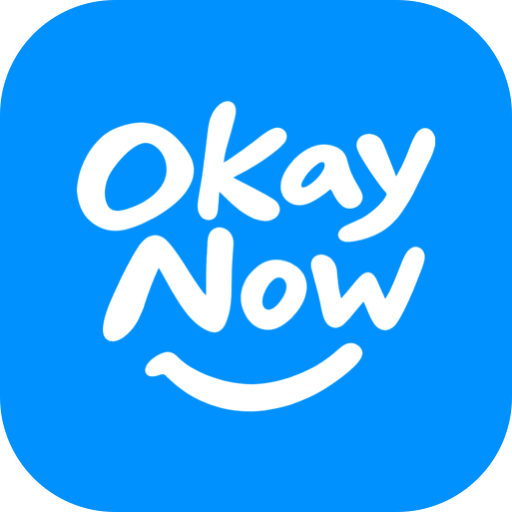
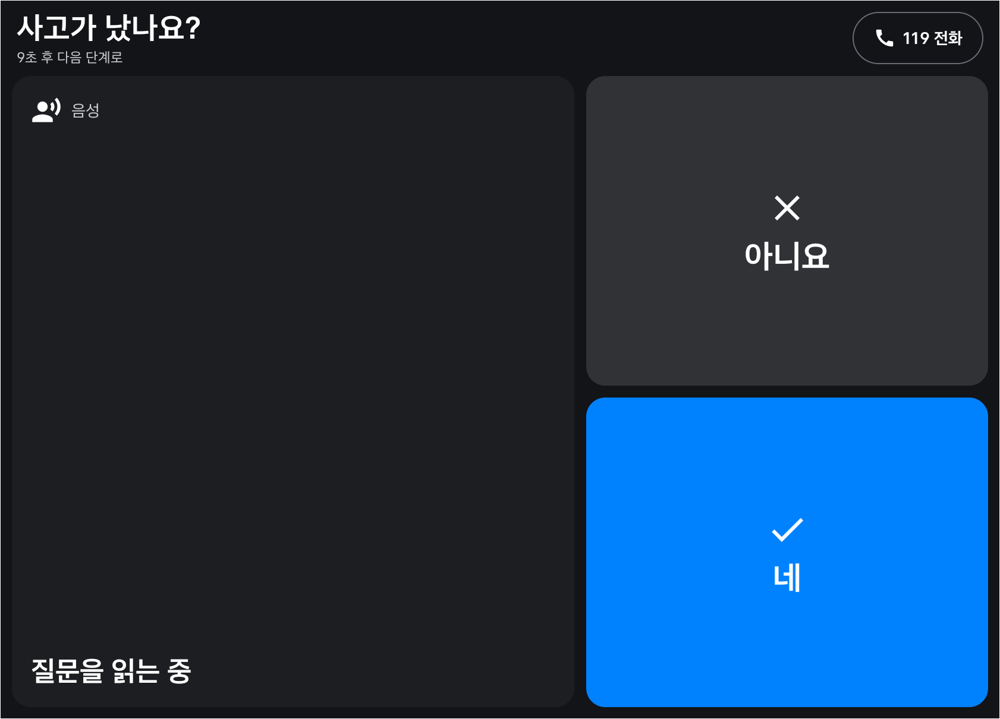
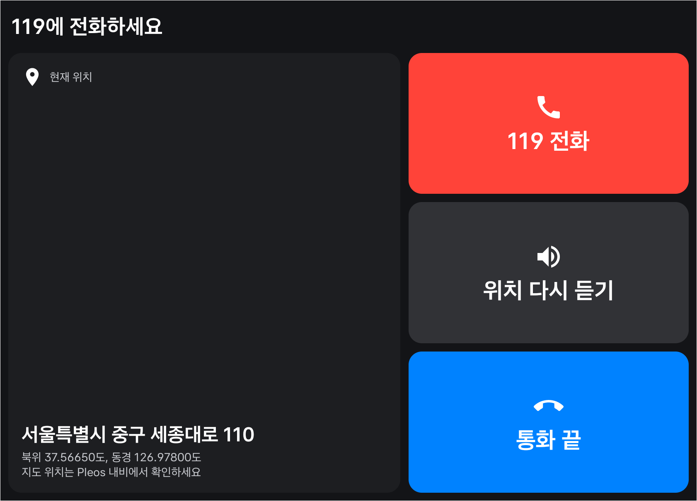
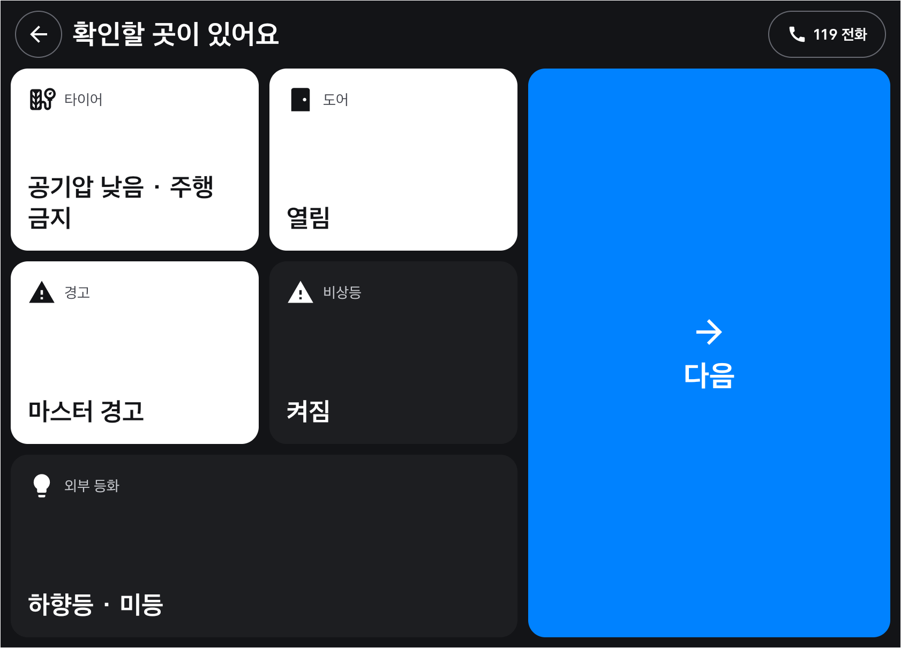
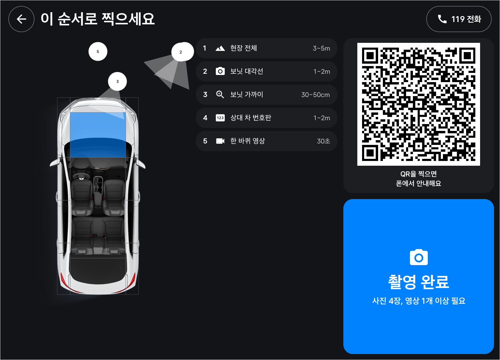
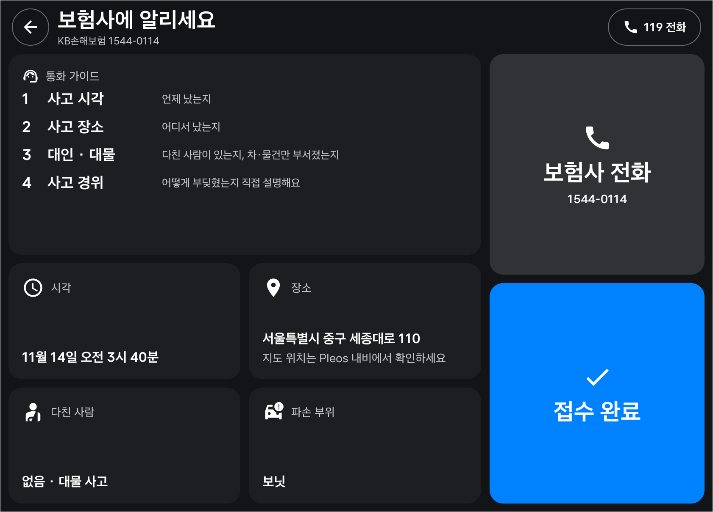
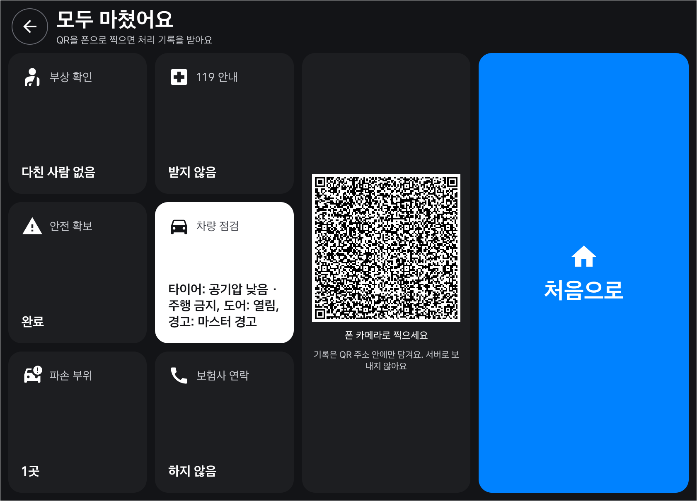
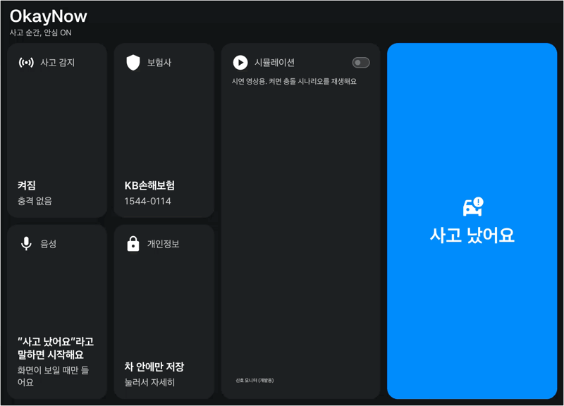

# OkayNow — 사고 순간, 안심 ON

> **처음 차사고를 겪는 운전자가 당황하지 않게 절차에 따라 사고 파악부터 보험사 연락까지의 과정을 도와주어 신속하게 사고 처리를 돕는 앱**

<p align="center"></p>

## 공모전 주요 정보

| 항목 | 내용 |
|---|---|
| 팀 | Whitemason |
| 앱 이름 | OkayNow (부제: 사고 순간, 안심 ON) |
| 패키지 | `com.whitemason.okaynow.app` |
| 버전 | 0.1.0 (versionCode 1) |
| 플랫폼 | Pleos Connect (Android Automotive OS, Android 14 / API 34), minSdk 28 |
| **APK** | [`apk/Whitemason_OkayNow_release.apk`](apk/Whitemason_OkayNow_release.apk) (서명된 release, 약 16MB) |
| 폰 웹 | https://okaynow.whitemason.club/ (소스: [whitemason/okaynow-pages](https://github.com/whitemason/okaynow-pages)) |
| 기획서 | [`docs/PROPOSAL.md`](docs/PROPOSAL.md) |
| 문의 | engineering@whitemason.club |

## 스크린샷

<table>
  <tr>
    <th>사고 확인 (C1)</th>
    <th>119 안내 (C3)</th>
    <th>차량 점검 (C5)</th>
  </tr>
  <tr>
    <td></td>
    <td></td>
    <td></td>
  </tr>
  <tr>
    <th>촬영 안내 (C6)</th>
    <th>보험사 접수 (C8)</th>
    <th>처리 기록 (C9)</th>
  </tr>
  <tr>
    <td></td>
    <td></td>
    <td></td>
  </tr>
</table>

전체 화면(C0~C9)은 [`docs/screens/`](docs/screens/) 폴더. 모두 Pleos Connect 에뮬레이터의 실제 앱 화면.

## 시연 영상



- 원본 영상: [`docs/demo.mp4`](docs/demo.mp4) (1080p, 약 48초, 왼쪽 차량 패널 포함)
- 녹화 조건: Pleos Connect Emulator v2.1.0, release APK, 시뮬레이션 모드 "충돌" 시나리오 (GIF는 1.5배속)

## 주요 기능

| 단계 | 화면 | 기능 | 주행 중 |
|---|---|---|---|
| C0 | 홈 | 백그라운드 사고 감지, 보험사 등록, 개인정보 안내, 시뮬레이션 모드 | 큰 버튼 1개만 |
| C1 | 사고 확인 | 속도·브레이크·비상등·기어·도어·안전 경고로 충격 추정, "사고가 났나요?" 음성 질문 | ○ |
| C2 | 부상 확인 | 다친 사람이 있으면 즉시 119 안내 | ○ |
| C3 | 119 안내 | 큰 119 버튼(번호가 채워진 전화 화면), 현재 위치(내비 주소) 표시와 낭독 | ○ |
| C4 | 안전 확보 | 비상등·대피·삼각대 안내 | P단에서 |
| C5 | 차량 점검 | 도어·등화·경고등 등 차량 상태 카드 | P단에서 |
| C6 | 촬영 안내 | 부딪힌 곳 선택 시 촬영 동선과 QR 표시, 폰에서 단계별 촬영 | P단에서 |
| C7 | 파손 맵 | 위에서 본 차 그림에 파손 부위 표시 (참고용) | P단에서 |
| C8 | 보험사 접수 | 통화 가이드(시각·장소·대인/대물·경위), 번호가 채워진 전화 화면 열기 (자동 발신 없음) | P단에서 |
| C9 | 완료 | 처리 체크리스트, 기록 QR (폰으로 보관·공유) | P단에서 |

- 모든 단계에서 버튼 이름 음성 명령 지원 (Gleo STT), 질문과 안내는 음성 낭독 (Gleo TTS)
- 주행 중에는 C1~C3의 음성과 큰 버튼만 표시, C4부터는 P단 전환 후 진행
- 사고 정보는 차 안에만 저장, 서버 전송 없음 (C0 → 개인정보)

## 실행 방법

빌드 없이 `apk/Whitemason_OkayNow_release.apk`만으로 시험 가능.

1. **에뮬레이터 준비**: Pleos Connect Emulator v2.1.0(API 34) AVD 생성 ([Pleos 시작하기](https://document.pleos.ai/docs/pleos-only/getting-started) 참고). 음성 인식 시험 시 호스트 마이크 연결 상태로 실행.
2. **APK 설치**: release APK를 에뮬레이터에 설치. 이 에뮬레이터는 앱을 user 10으로 실행.
3. **권한 허용**: 첫 실행 시 뜨는 속도·알림·위치 권한 창에서 모두 허용. 권한 창 없이 실행된 경우 권한 부여 후 앱 재실행.
4. **보험사 등록 (선택)**: C0 홈의 "보험사" 칸 → 목록 선택 또는 직접 입력 → 저장. 등록 후 C8의 "보험사 전화" 버튼 활성화.
5. **사고 흐름 시험**: 아래 둘 중 하나.
   - **시뮬레이션 모드 (권장)**: C0 오른쪽 "시뮬레이션" 켜기 → **충돌** 선택. 약 5초 뒤 충격 감지와 함께 C1 표시, 약 15초 뒤 P단 전환과 함께 C4 이후 단계 진행. **저속 접촉**은 자동 감지 기준 미달 사례(수동 시작 경로), **급정차 오탐**은 감지하지 않아야 하는 사례.
   - **수동 시작**: C0의 **사고 났어요** 버튼 또는 "사고 났어요" 음성. 기어는 Virtual Console(Emulation Controls → Gear Selection)에서 P로 설정.
6. **폰으로 이어 보기**: C6 QR 촬영 시 단계별 촬영 안내(사진·영상 촬영과 저장), C9 QR 촬영 시 처리 기록 표시. 별도 설정 불필요.

## 테스트 환경

| 항목 | 내용 |
|---|---|
| 에뮬레이터 | Pleos Connect Emulator v2.1.0 (Android 14 / API 34, `pleos_car_emulator` arm64, 2560×1440) |
| 호스트 | macOS, Android Studio 2026.2, Android SDK Emulator 37.2.12 |
| 폰 웹 | iPhone Safari, Android Chrome (QR 진입, 카메라 촬영, 저장) |
| 단위 테스트 | 112개 통과 |

에뮬레이터 확인 결과와 한계:
- 동작 확인: 속도·브레이크·기어·도어·안전 경고·외부 등화·내비 주소·Gleo TTS/STT
- 에뮬레이터 미지원: 비상등·타이어 공기압·에어백 속성. 앱은 지원 여부 확인 후 해당 칸 숨김. 비상등·에어백이 포함된 사고 판단은 시뮬레이션 모드와 단위 테스트로 확인
- 기어 변경은 Virtual Console로만 가능 (adb 주입 불가)

## 개발자 안내 (선택 사항)

APK 시험에는 별도 설정 불필요. 소스에서 빌드하는 경우에만 아래 설정 필요.

### 필요한 설정

| 설정 | 위치 | 필수 | 설명 |
|---|---|---|---|
| `sdk.dir` | `local.properties` | 빌드 시 | Android SDK 경로. Android Studio로 열면 자동 생성 |
| `release.storeFile`, `release.storePassword`, `release.keyAlias`, `release.keyPassword` | `local.properties` | release 빌드 시 | 서명 키 정보. 키와 비밀번호는 저장소에 없음. 없으면 서명 없는 APK 생성 |
| `guide.baseUrl` | `local.properties` | 아니요 | 폰 웹 주소. 기본값 `https://okaynow.whitemason.club/`. 웹을 로컬에서 고쳐 볼 때만 변경 |

`local.properties`는 커밋 대상 아님 (`.gitignore`).

### 구조

Clean Architecture 3계층과 단방향 MVI. 의존 방향은 `presentation → domain ← data`, 연결은 `di/AppModule`(Hilt) 담당.

```
okaynow-pleos/
├── app/                          Android 앱 모듈
│   └── src/main/java/com/whitemason/okaynow/app/
│       ├── domain/               순수 Kotlin (Android·SDK 의존 없음, 단위 테스트 대상)
│       │   ├── vehicle/          VehicleSignalSource·SignalSourceRepository(인터페이스), VehicleStatus
│       │   ├── location/         LocationSource(인터페이스), LocationFix·낭독 문장
│       │   ├── voice/            VoiceGuide(인터페이스), matchAnswer
│       │   ├── detection/        ImpactScorer·ImpactConfig, 신호 → 충격 점수 스트림
│       │   ├── flow/             AccidentState·AccidentEvent, AccidentFlowStateMachine(안전 규칙)
│       │   ├── damage/           CarZone(12구역), ShotPlan(촬영 동선·문구)
│       │   ├── report/           AccidentReport, 기록 JSON·QR 링크, 보험사 목록
│       │   └── common/           Clock, FlowLogger
│       ├── data/                 domain 인터페이스 구현 (Pleos SDK·시연)
│       │   ├── vehicle/          PleosVehicleSignalSource, FakeSignalSource·FakeScenario, SignalSourceSelector
│       │   ├── location/         PleosLocationSource·PleosNaviAddress, FakeLocationSource, LocationRepository
│       │   ├── voice/            PleosVoiceGuide (Gleo TTS·STT ON_DEVICE)
│       │   └── report/           기록 보관(앱 내부 파일), 보험사 등록(DataStore)
│       ├── presentation/
│       │   ├── accident/         MVI: AccidentContract·AccidentReducer(순수)·AccidentStore·AccidentViewModel, VoicePrompts
│       │   ├── screens/          C0~C9 Compose 화면, AccidentApp(상태 구독과 일회성 효과)
│       │   ├── components/       StepScaffold·타일·버튼, TopViewCar, QrCode, VoiceStatus
│       │   ├── theme/            회색조와 브랜드 색
│       │   └── monitor/          개발용 신호 모니터 (MVI 밖)
│       ├── service/              DetectionService (포그라운드, 백그라운드 사고 감시)
│       └── di/                   AppModule (domain ← data 바인딩, Clock·Logger)
├── apk/                          제출용 release APK
└── docs/                         PROPOSAL.md(기획서), screens/(앱 화면), brand/(아이콘), demo.gif·demo.mp4(시연 영상)
```

**MVI 흐름**: 화면은 `AccidentUiState`만 그리고 입력은 `AccidentIntent` 하나로 전달 → `AccidentReducer`가 새 상태와 `AccidentSideEffect`(음성·타이머·위치·신호원 전환) 반환 → `AccidentStore`가 부수 효과 실행 후 결과(음성 답·타이머 종료·위치·차량 신호)를 다시 Intent로 전달. 119 다이얼처럼 화면에서만 가능한 일은 `AccidentUiEffect`로 한 번 전달. DetectionService와 화면은 같은 Store 공유.

### 사용 권한

| 권한 | 용도 |
|---|---|
| `pleos.car.permission.CAR_DRIVE` | 브레이크 페달, 기어 |
| `pleos.car.permission.CAR_DOORS` | 도어 열림 |
| `pleos.car.permission.CAR_SAFETY` | 에어백 전개, 파워다운 경고 |
| `pleos.car.permission.CAR_LIGHTS` | C5 외부 등화 (하향등·상향등·미등·안개등) |
| `android.car.permission.CAR_SPEED` | 차량 속도 (AAOS `PERF_VEHICLE_SPEED`) |
| `ai.pleos.playground.service.vehicle.VEHICLE_BINDING` | Vehicle SDK AAR 자동 병합 |
| `android.permission.FOREGROUND_SERVICE`, `FOREGROUND_SERVICE_SPECIAL_USE` | DetectionService (주행 중 백그라운드 사고 감시) |
| `android.permission.POST_NOTIFICATIONS` | 상주 알림, 충격 감지 헤드업 알림 (런타임 요청) |
| `pleos.car.permission.TTS_SERVICE`, `STT_SERVICE` | 음성 질문·응답 (ON_DEVICE). AAR이 `INTERNET` 자동 병합 |
| `pleos.car.permission.FUSED_LOCATION` | C3 현재 위치 좌표 (dangerous, 런타임 요청). AAR이 `FUSED_LOCATION_BINDING` 자동 병합 |
| `pleos.car.permission.NAVI_ROUTE` | C3 현재 위치 주소 (NaviHelper `getCurrentLocationInfo`) |
